<p align="center">
  
</p>

# Kame Space

**A multi-tenant short-term rental platform for guests and hosts: listings, booking workflow, inbox, marketing, pricing, finance, and parking in one workspace.**

Guests search stays and parkings across the Philippines, book on a calendar, and complete forms with IDs, receipts, and building documents. Hosts run each stay through a status workflow with email, AI checks, calendar sync, Meta inbox, Marketing Studio, and org-level plans. Built as a **Vite + React** SPA with **Supabase Edge Functions** (Deno), **Postgres**, and **PWA** install for the host dashboard.

Live: **[kamespace.com](https://kamespace.com)**

<p align="center">
  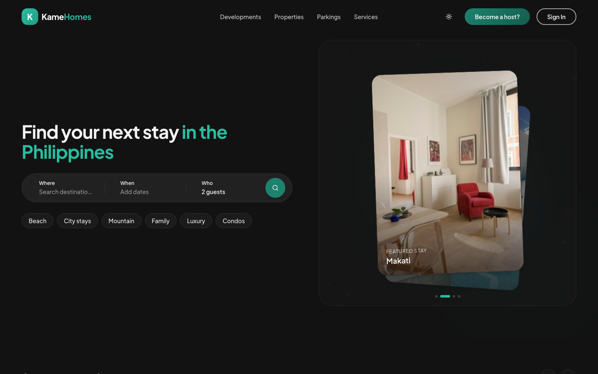
</p>

<p align="center">
  <a href="#features">Features</a> ·
  <a href="#screenshots">Screenshots</a> ·
  <a href="#tech-stack">Tech Stack</a> ·
  <a href="#getting-started">Getting Started</a> ·
  <a href="#documentation">Documentation</a>
</p>

<p align="center">
  
  
  
  
  
  
  
  
  
  
</p>

---

## Features

### Guest marketplace

- Search **properties**, **parkings**, and **developments** with destination, dates, guests, and filters
- Public listing pages with media, host contact, and nightly price
- Availability **calendar** → guest form → confirmation (IDs, receipts, pets, parking when required)
- Stay guide, showcase pages, security-deposit form, and guest review flows
- Authenticated **guest portal** (`/account`): trips, chat, profile, vouchers, tickets

### Booking workflow

- Status machine: `PENDING_REVIEW` → documents → check-in → check-out → SD refund → `COMPLETED` (plus `CANCELLED`)
- Guest Advice Form (GAF) / pet PDFs, Azure inbound approval email, and guest acknowledgement mail
- AI receipt checks, voucher reveal, and same-day urgent ops subjects (Asia/Manila)
- Every transition goes through a shared workflow orchestrator (email, calendar, sheets, activity log)

### Host dashboard

- Property overview: revenue, occupancy, calendar, and “needs attention”
- Bookings table and board with filters, status moves, and document review
- Org, property, and **parking** as peer verticals with separate RBAC
- Team invites, permission leaves, and seeded role templates
- Activity log, notifications, Web Push, and offline-friendly PWA shell

### Inbox & messaging

- Guest Inbox for Meta (Messenger / Instagram) plus in-app web chat
- AI-assisted replies with host control
- Per-property Telegram bots for ops, staff, finance, and maintenance

### Marketing Studio

- Theme-first creative workspace: AI Studio, Posts, Videos, Calendar
- Polotno editors, Remotion video, Gemini / Veo generation, AI poster studio
- Meta publish when the plan allows

### Pricing, calendars & analytics

- Nightly rate calendar with AI **smart pricing** and optional autopilot
- Two-way **iCal** sync (Airbnb, Booking.com, Vrbo) on Pro+
- Host analytics: occupancy / ADR, export, and AI review drafts
- Review automation after checkout

### Finance, maintenance & parking

- Finance line items, recurrence, and Telegram reminders
- Maintenance tracking alongside stay operations
- Parking marketplace: guest broadcast → host claim → PayMongo checkout → endorsement

### AI assistant & plans

- Dashboard AI assistant with tools (sheet or full-page AI mode) and credit wallet
- Org-level **plans** (Free → Business) with feature gates and public pricing
- Super-admin console for platform health, feature availability, and step-up OTP writes

---

## Screenshots

### Guest

|                       Landing                        |                    Properties                    |
| :--------------------------------------------------: | :----------------------------------------------: |
|  | 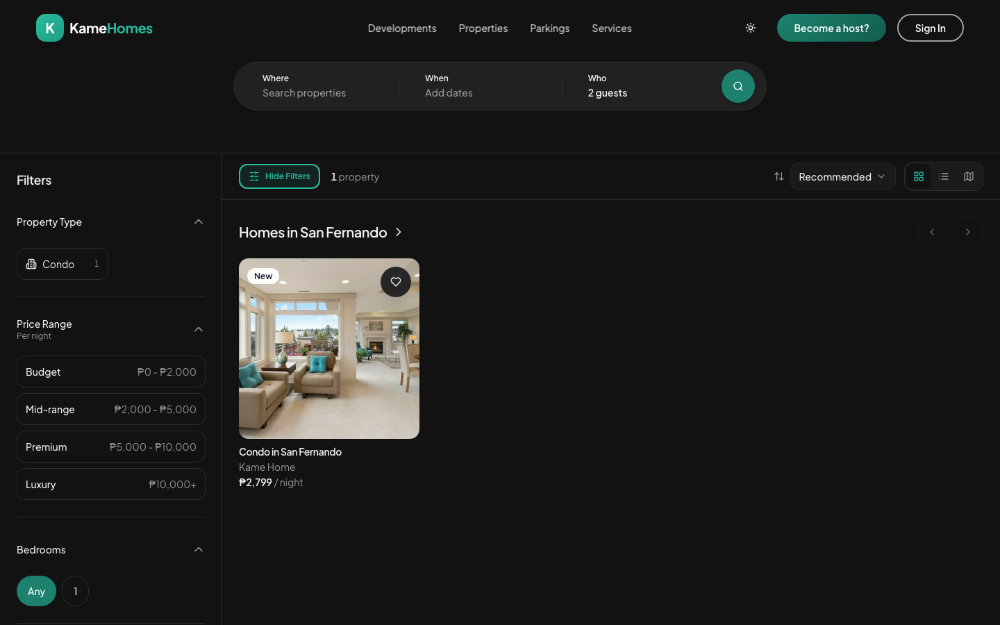 |

|                           Listing                            |                       Calendar                        |
| :----------------------------------------------------------: | :---------------------------------------------------: |
| 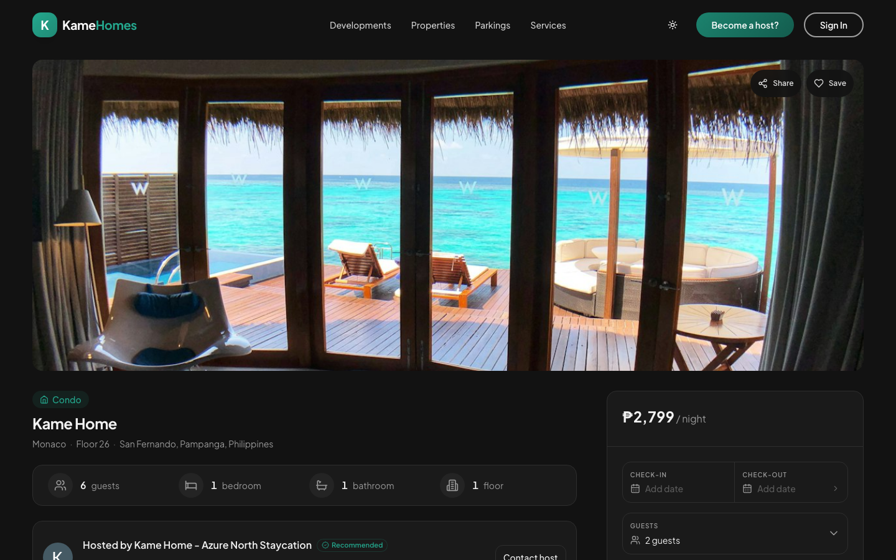 | 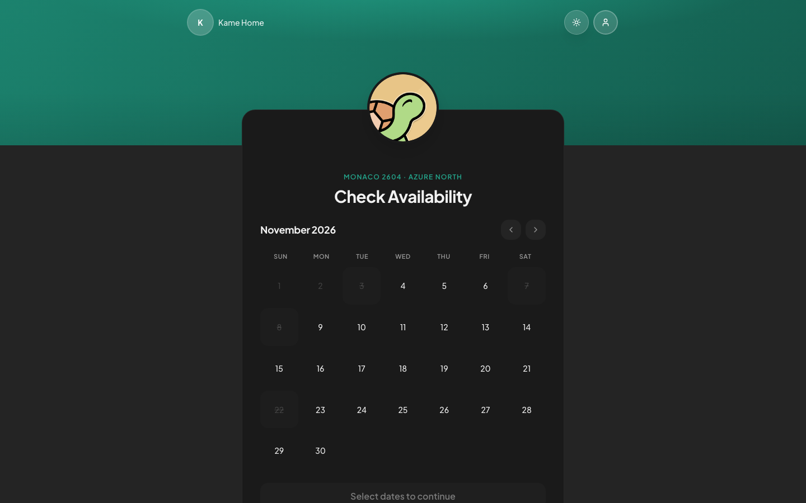 |

### For hosts

|                   For hosts                    |                      Product tour                      |
| :--------------------------------------------: | :----------------------------------------------------: |
| 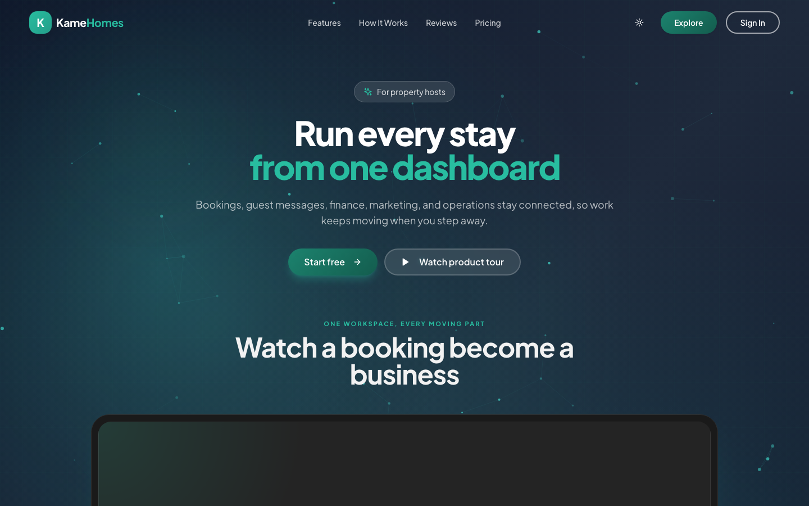 | 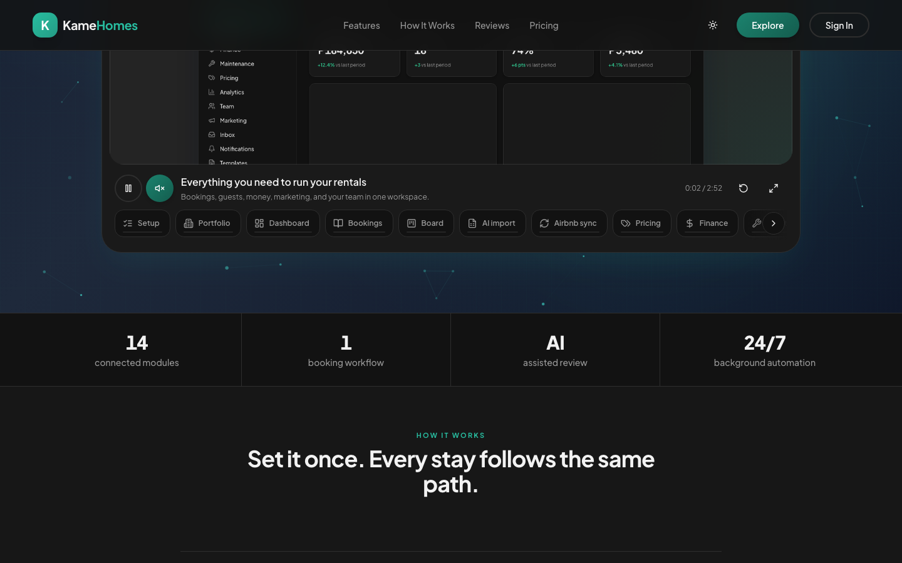 |

|                  Pricing                   |                  Sign in                   |
| :----------------------------------------: | :----------------------------------------: |
| 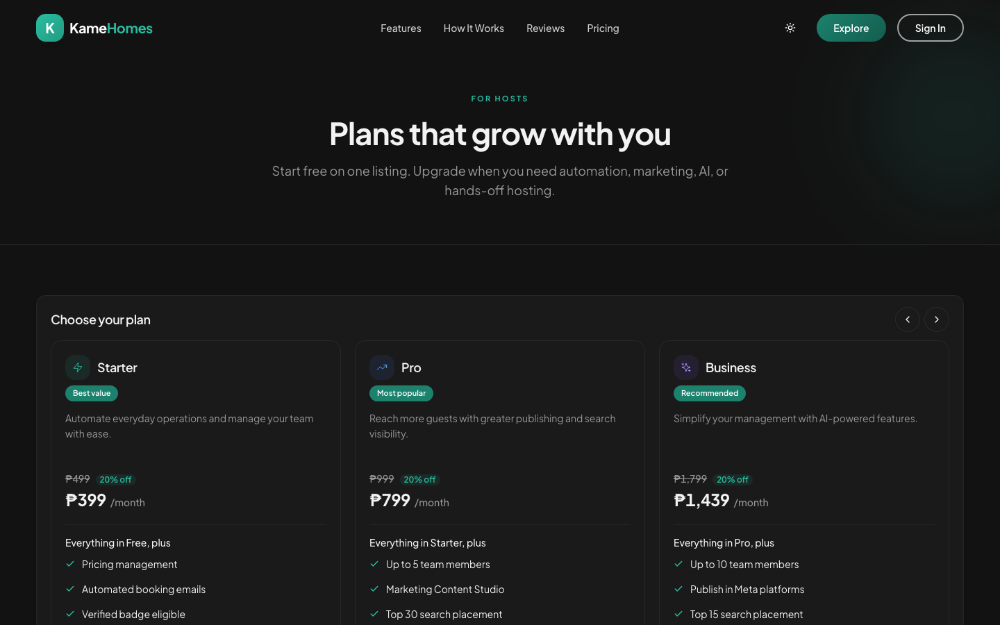 | 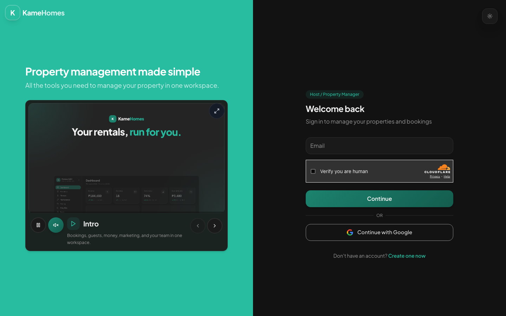 |

### Host app

|                      Dashboard                      |                     Bookings                      |
| :-------------------------------------------------: | :-----------------------------------------------: |
| 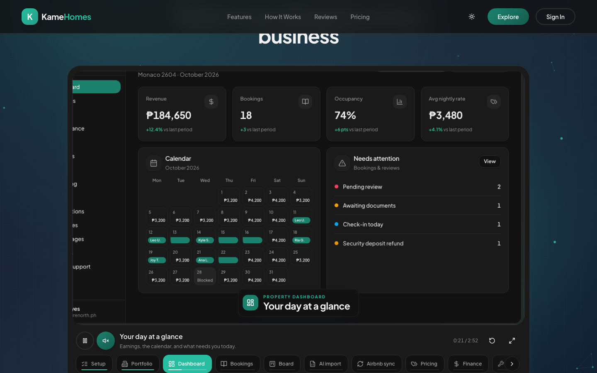 | 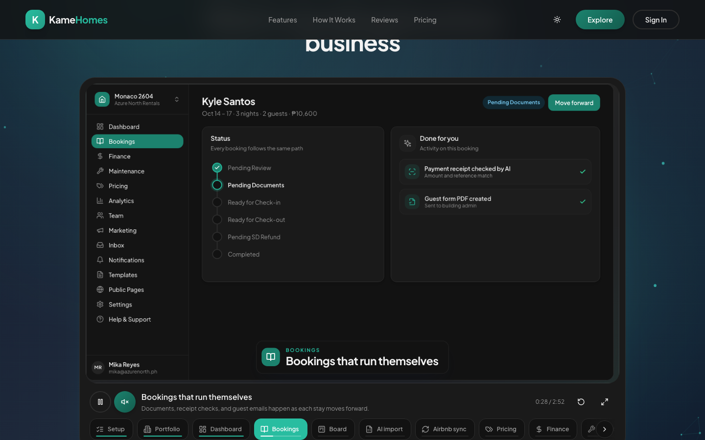 |

|                    Board                    |                    Inbox                    |
| :-----------------------------------------: | :-----------------------------------------: |
| 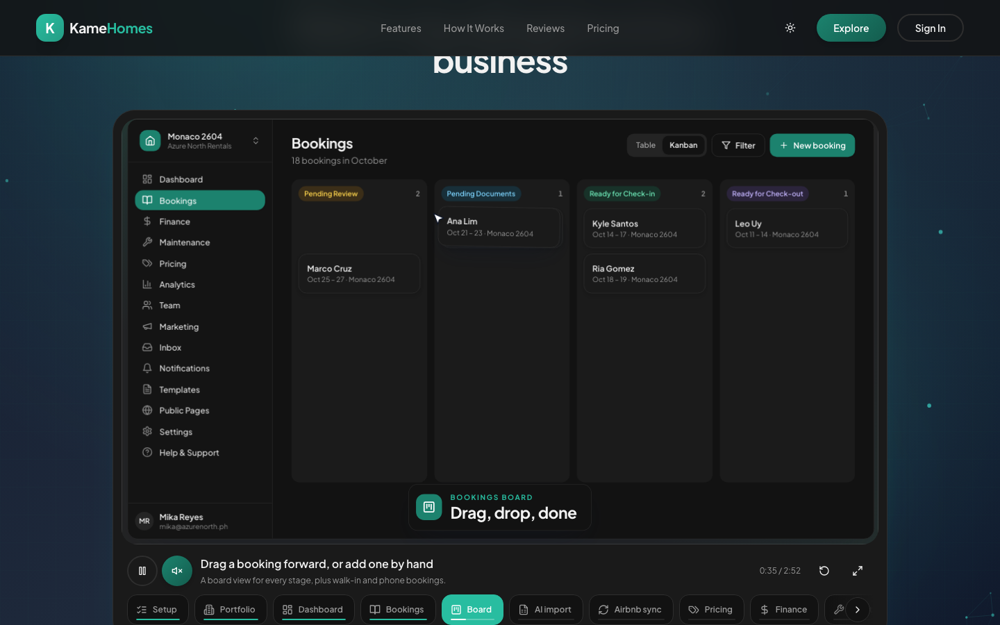 | 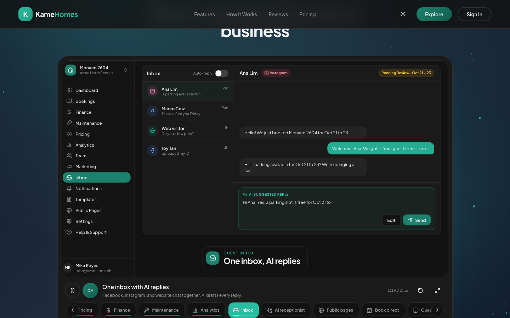 |

|                     Pricing                     |                     Finance                     |
| :---------------------------------------------: | :---------------------------------------------: |
| 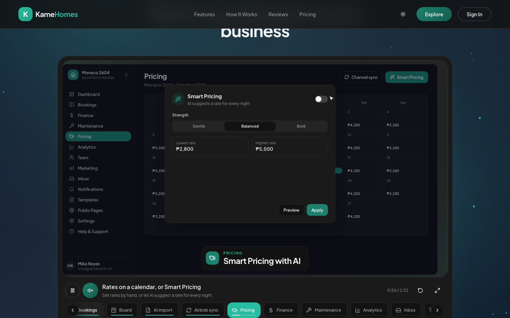 | 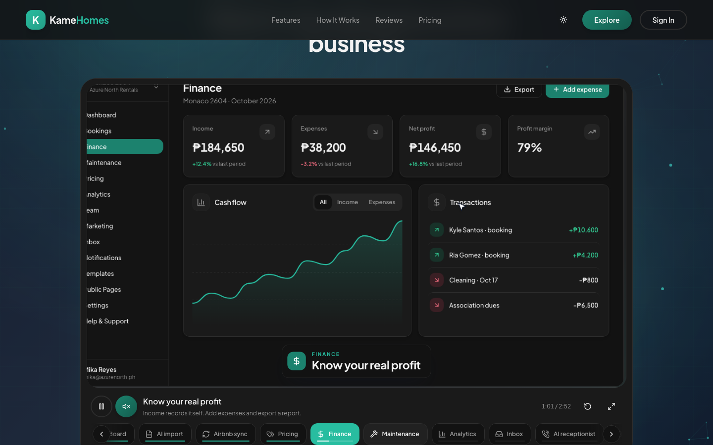 |

More captures and regenerate notes: [`docs/screenshots/README.md`](./docs/screenshots/README.md).

---

## Tech Stack

| Layer        | Technology                                                                    |
| ------------ | ----------------------------------------------------------------------------- |
| Package mgr  | [Bun](https://bun.sh)                                                         |
| Frontend     | [Vite](https://vitejs.dev/) + [React 19](https://react.dev/) + React Router 7 |
| UI           | Tailwind 3, Radix / shadcn, RHF + Zod, TanStack Query 5, Recharts, Lucide     |
| PWA          | `vite-plugin-pwa`, Web Push, offline drafts / outbox                          |
| **API**      | [Supabase Edge Functions](https://supabase.com/docs/guides/functions) (Deno)  |
| **Database** | Postgres (plain SQL migrations), Storage, Auth, Realtime                      |
| Jobs         | Hosted `pg_cron` + `pg_net` → edge cron handlers                              |
| Email        | [Resend](https://resend.com/) (outbound + inbound approvals)                  |
| Payments     | [PayMongo](https://www.paymongo.com/) (plans + parking checkout)              |
| AI           | Gemini / Groq / Veo via shared edge AI gateway                                |
| Messaging    | Meta Graph, Telegram                                                          |
| Auth         | Supabase Auth + Google OAuth (hosts); separate guest Auth for `/account`      |
| Hosting      | [Vercel](https://vercel.com/) (`kame-homes`) + Supabase                       |
| Tests        | Vitest, Deno tests, Playwright (`@smoke` / `@ci`)                             |

Full picture: [`docs/architecture/overview.md`](./docs/architecture/overview.md). Topic index: [`docs/PROJECT.md`](./docs/PROJECT.md).

---

## Getting Started

### Prerequisites

- [Bun](https://bun.sh)
- [Docker](https://www.docker.com/) (local Supabase)
- Google OAuth credentials for host sign-in (optional for UI-only against a remote project)

### 1. Clone and install

```bash
git clone https://github.com/sprmke/kame-space.git
cd kame-homes
bun install
bun run setup:ai-tooling   # once; Cursor / Claude / OpenCode links
```

### 2. Run locally

```bash
./dev.sh              # Docker + local Supabase + UI
./dev.sh --ui-only    # UI only (remote Supabase in ui/.env.development)
```

Open the Vite URL printed by the script (typically [http://localhost:5173](http://localhost:5173)).

**VS Code / Cursor:** Terminal → Run Task for full stack, Supabase, quality, and deploy. Default build task: **Dev: Full stack**.

### 3. Quality

```bash
bun run lint
bun run type-check
bun run build
bun run ci:quality    # PR parity: lint, types, filenames, tests, build
```

---

## Scripts

| Command                                                 | Description                   |
| ------------------------------------------------------- | ----------------------------- |
| `./dev.sh` / `./dev.sh --ui-only`                       | Full stack or UI only         |
| `bun run start:supabase` / `stop:supabase` / `db:reset` | Local Supabase                |
| `bun run db:migrate`                                    | Apply local migrations        |
| `bun run lint` / `type-check` / `build`                 | Quality                       |
| `bun run test` / `test:edge` / `test:e2e:smoke`         | Vitest, Deno, Playwright      |
| `bun run ci:quality`                                    | Full CI gate                  |
| `bun scripts/dev/capture-readme-screenshots.mjs`        | Regenerate README screenshots |

Production Supabase deploys need the unlock word **`kamewave`** in-session. See [`.cursor/rules/no-prod-deploy.mdc`](./.cursor/rules/no-prod-deploy.mdc).

---

## Documentation

| Doc                                                                                        | Purpose                |
| ------------------------------------------------------------------------------------------ | ---------------------- |
| [`docs/README.md`](./docs/README.md)                                                       | Documentation index    |
| [`docs/architecture/overview.md`](./docs/architecture/overview.md)                         | Full-app architecture  |
| [`docs/PROJECT.md`](./docs/PROJECT.md)                                                     | API, env, topic index  |
| [`docs/guides/routes/`](./docs/guides/routes/)                                             | Per-route behavior     |
| [`docs/architecture/plans-feature-matrix.md`](./docs/architecture/plans-feature-matrix.md) | Plan / feature gates   |
| [`scripts/README.md`](./scripts/README.md)                                                 | Automation scripts     |
| [`.cursor/rules/README.md`](./.cursor/rules/README.md)                                     | Agent rules and skills |

---

## Project structure

```text
ui/                      # Vite React SPA (guest + host dashboard)
supabase/
  functions/             # Deno edge functions + _shared services
  migrations/            # Postgres SQL
docs/                    # Architecture, route guides, workflow
scripts/                 # Dev, deploy, data, screenshot helpers
```

---

## License

Private repository. All rights reserved.
